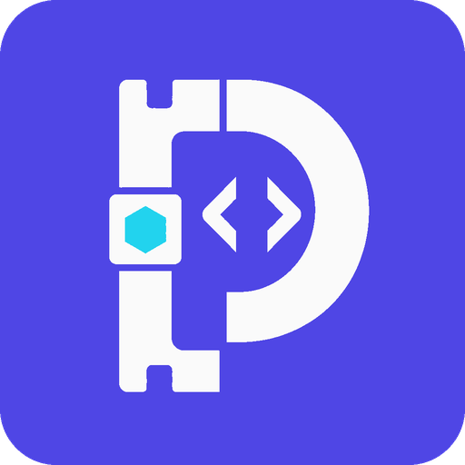

<p align="center">
  
</p>

<h1 align="center">PureTools</h1>

English | [中文](README.zh-CN.md)

PureTools is a lightweight, privacy-first, pure-frontend toolkit for developers. Core processing happens locally in the browser with no application backend; individual tools may read clearly identified public reference data.

## Highlights

- Pure frontend, no backend required
- Privacy-first: data never leaves your device
- Dark/light mode with system sync
- Four navigation groups with a compact, scrollable Tools menu and global `/` search

## Tools

- UUID Generator (RFC 4122 v4): generate, validate, history, copy
- Random String Generator: email-prefix-friendly presets, batch generation, copy, history
- JSON Formatter: format, minify, validate, escape/unescape, syntax highlight, line numbers, copy
- SQL Formatter: format/minify, basic validation (strings/parentheses), line numbers, copy
- [Markdown Previewer](docs/markdown-preview.md): local CommonMark or Enhanced preview with GFM, math, Mermaid, and safe static HTML
- Local Translator: private on-device translation with language detection and model download progress
- Regex Tool: validate, test, highlight matches, generator templates
- CRON Tool: 5-field CRON validator and generator
- Base64 Tool: encode/decode, URL-safe mode
- URL Encoder: encode/decode (component/full URL)
- QR Code Generator: generate and download QR codes from exact plain-text input
- JWT Decoder: header/payload decode, time claim insights
- Hash Calculator & Verifier: MD5 and SHA-1/256/384/512 for exact UTF-8 text and local files, checksum comparison, chunked progress and cancellation
- Timestamp Tool: timestamp <-> local datetime, seconds/milliseconds, local + UTC outputs, copy
- [Time Zone Converter & World Clock](docs/timezone.md): IANA regions, fixed PST/PDT offsets, explicit DST overlap/gap handling, live city clocks with saved preferences
- GitHub CDN: convert GitHub/raw links to raw + jsDelivr URLs, copy
- Reference exchange rates: read public reference rates while keeping amounts, conversion, and caching local

## Tech Stack

- SvelteKit (Svelte 5 Runes) + Vite
- TypeScript (strict)
- Tailwind CSS v4
- Biome (lint/format)
- Cloudflare adapter (deployment target)

## Local Development

1. Install dependencies:

```sh
bun install
```

2. Start the dev server:

```sh
bun run dev
```

## Scripts

- `bun run dev`: start dev server
- `bun run build`: build for production
- `bun run preview`: preview production build
- `bun run test`: run unit and browser end-to-end tests
- `bun run test:unit`: run Bun unit tests
- `bun run test:e2e`: run Playwright browser tests
- `bun run test:exchange-rate:live`: verify the live rate API, CORS policy, and response contract
- `bun run check`: type-check and sync
- `bun run lint`: lint + type-check
- `bun run lint:fix`: auto-fix lint issues
- `bun run format`: format code
- `bun run cf:dev`: run Wrangler local dev
- `bun run cf:deploy`: deploy to Cloudflare Workers

## Notes

- Core processing runs locally in the browser and user input is not uploaded; the exchange-rate tool only downloads a public rate table.
- `/hash` keeps SHA-256 as the default. Nonempty text is calculated after a 250 ms debounce;
  use Calculate for empty text or a selected/dropped single file. Expected checksums accept outer
  whitespace and either hex case; editing them only compares the existing result.
- Hashing never uploads or persists text, files or expected checksums. SHA text uses Web Crypto
  (HTTPS or localhost); MD5 text and all file algorithms use locally bundled, lazy-loaded
  `hash-wasm` 4.12.0 ([MIT license](static/licenses/hash-wasm.txt), zero runtime dependencies). Files are read as raw bytes in sequential
  4 MiB slices in a dedicated Web Worker; cancel, source changes and navigation terminate it.
  Browsers must support Workers, Blob slice/arrayBuffer and WebAssembly for files; unsupported
  environments show an error. There is no whole-file fallback or unlimited file-size guarantee:
  browser/device resources and processing time still apply. Input data stays in page memory only.
- Matching hashes do not establish a trusted source. MD5 has collision weaknesses and is unsuitable
  for password storage, security signatures or protection against malicious tampering. Prefer SHA-256.
- Local Translator requires desktop Chrome 138 or later. Translation models are downloaded and
  managed by Chrome on demand.
- Playwright uses the bundled Chromium binary on Linux x64. Linux arm64/other architectures, macOS, and Windows use Playwright's native browser installation; run
  `bunx playwright install chromium` once before `bun run test:e2e` on those platforms.

## Brand Assets

- [Generated high-resolution logo original](static/brand/puretools-logo-original.png)
- [Production logo](static/brand/puretools-logo.png)
- [Generation prompt](docs/brand/puretools-logo-prompt.txt)
- [Refinement prompt](docs/brand/puretools-logo-refinement-prompt.txt)

## License

This project is licensed under the GNU Affero General Public License v3.0 or later (`AGPL-3.0-or-later`). See the [LICENSE](LICENSE) file for details.
